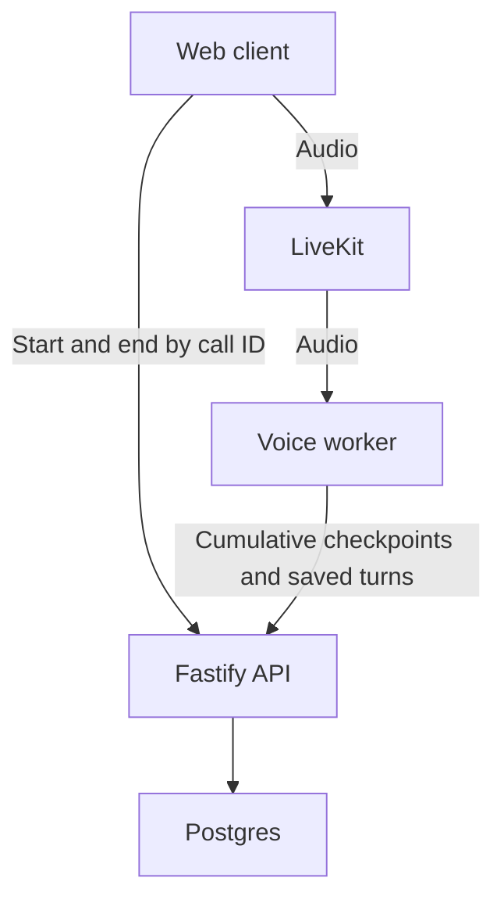

# 🎙️ Voice Mode — Operator Guide

Single-source-of-truth doc for **voice mode**, now shipped on `main`.
Covers how to enable/disable voice mode, what services run, and a manual
smoke-test checklist to re-run before a release or after any change that
touches the voice path (worker, providers, LiveKit, or the `/voice/*`
routes).

> Voice mode landed via `feat/voice-mode`. This doc has outlived the
> merge — treat the checklist below as an acceptance / regression suite,
> not a one-time merge gate.

## 🏗️ Architecture in 30 seconds

* **`web`** mints the LiveKit token via `POST /v1/sessions/:id/voice/start`
  and joins the SFU as a publisher/subscriber.
* **`livekit`** (Docker container, dev mode) routes audio between the
  user and the agent worker.
* **`agent-voice`** joins the room and runs STT → LangGraph → TTS.
  It loads state and persists turns through `/internal/sessions/:id/*`
  using `X-Internal-Key`. No user credential appears in participant
  metadata; metadata carries only `session_id` and `call_id`.
  Streaming replies are saved before forwarding. Shutdown drains pending
  utterances and saves an unspoken final turn, preserving transcripts.
* **`api`** owns entitlement resolution, call reservations, and UTC daily
  usage. `voice_calls` retains each UUID, room, owner, duration checkpoints,
  processed sequence, charged seconds, reservation order, and start/end times. A user-row lock
  and a partial unique index enforce one active call across sessions and
  API instances. Rejoining the same active session returns the existing
  call and room. Every end request includes the exact `call_id`.

### Daily budgets and runtime cutoff

Free uses the configured `VOICE_DAILY_MINUTES_PER_USER` (default **60**).
Plus and Supporter both use `PRO_VOICE_DAILY_MINUTES_PER_USER` (default
**720**). Monthly and yearly plans share the same daily counters and
limits. The API resolves current entitlements on every checkpoint; an
upgrade raises the ceiling and a downgrade reuses the consumed seconds.

The worker sends cumulative duration every **15 seconds** to
`POST /internal/voice/calls/:callId/checkpoint`, authenticated with
`X-Internal-Key`. The payload is `{sequence, cumulative_seconds, ended}`.
The API resolves ownership from the call row, deduplicates sequences,
rejects durations beyond observed wall time, and splits accepted duration
at midnight UTC. Responses include `remaining_seconds`, `cap_seconds`,
`usage_date`, `reset_at`, and `continue_call`. The worker refreshes again
at midnight or when its remaining allowance expires.

The first checkpoint must succeed before providers or audio work start.
Subsequent failures stop audio by **25 seconds** after the last confirmed
budget, leaving a bounded **5 seconds** for SFU room termination. The
worker publishes `quota_warning` before a budget cutoff and
`quota_exhausted` at cutoff; both include `call_id`. The web surface
ignores events and cleanup callbacks belonging to older calls. Pending
transcripts are flushed, a final checkpoint is attempted, and final
analysis is reported separately without a second debit. Failed recovery
requests are logged with call identity; durable checkpoints remain.

`VOICE_ACTIVE_CALL_STALE_SECONDS` defaults to **60 seconds**, independent
of the allowance. Checkpoints renew this lease. Reclaiming a stale call
terminates its old SFU room before releasing the reservation; if room
termination fails, starting a replacement fails closed. The old worker
receives `continue_call: false` on its next checkpoint. Final checkpoints
for closed calls may settle only their bounded, server-observed duration,
and cannot end or overwrite a replacement call. Stale worker loss is
bounded by the checkpoint interval in normal operation; API outages may
leave up to the fail-closed window unreported.

### Join credentials and reconnects

Join JWTs expire after **10 minutes**, independently of daily voice time.
[LiveKit's token documentation](https://docs.livekit.io/frontends/reference/tokens-grants/)
explains that expiry affects initial joins, and that connected clients
receive refreshed credentials for SDK reconnects. A token is therefore
not a runtime usage timer. Fresh application joins resolve ownership and
current budget again. Self-hosted LiveKit does not revoke old tokens on
participant removal, so every worker must reauthorize the durable call
identity before starting providers; a cached token for an ended or
replaced call cannot restart paid voice work.

Before launch, validate the deployed self-hosted reconnect behavior:
keep a call connected past ten minutes, interrupt networking, confirm the
SDK reconnects to the same call, then exhaust/revoke its allowance and
confirm runtime cutoff and durable transcript recovery. This is a manual
acceptance check; unit tests do not certify a running SFU deployment.

## 🛑 Kill switches (no rebuild required)

Setting `VOICE_ENABLED=false` in **either** the `api` or the
`agent-voice` env disables voice end-to-end:

* `api` returns `503 voice_disabled` from every `/voice/*` route.
* `agent-voice` exits 0 cleanly so docker-compose's restart policy
  doesn't loop.
* `web` reads `NEXT_PUBLIC_VOICE_ENABLED=false` and hides the call
  button.

You only need to flip **one** of these to turn the feature off; flipping
all three is the cleanest revert if you want to remove the UI affordance
on top of disabling the backend.

## 🔀 Provider selection

The defaults are self-hosted:

| Layer | Default       | Cloud option(s)                    |
|-------|---------------|------------------------------------|
| STT   | `whisper_local` (`faster-whisper`) | `whisper_openai`, `deepgram` |
| TTS   | `piper_local` | `openai_tts`, `elevenlabs`         |

Switch globally via env (`VOICE_STT_PROVIDER`, `VOICE_TTS_PROVIDER`).
Personas can override the TTS provider via
`persona.voice.providerOverride`; see `agent/data/personas.json` for
the per-persona voice blocks.

## ✅ Smoke checklist

Run through this list **before a release** and **after any change that
touches the voice path**. Each step should leave a green check (or a
documented reason for skipping).

### ❄️ A. Cold-start with all defaults

- [ ] `docker compose -f docker-compose.local.yml up --build` starts
      `livekit`, `agent`, `agent-voice`, `api`, `web`, `postgres`,
      `redis` cleanly. No restart loops in the first 60 seconds.
- [ ] `docker compose logs agent-voice | head -20` shows
      "voice enabled" and the worker registered with LiveKit.
- [ ] `curl -fsS http://localhost:7880` returns the LiveKit health page.

### 🎫 B. Token mint + ownership

- [ ] `POST /v1/sessions/:id/voice/start` (with valid bearer) returns
      `200` with a non-empty `token`, `livekit_url`, `room`, `call_id`, and a
      `quota_remaining_seconds` consistent with the account’s resolved daily allowance.
- [ ] `POST /v1/sessions/:id/voice/start` from a *different* user's bearer
      returns `403`.
- [ ] `POST /v1/sessions/:id/voice/start` for an unknown session returns
      `404`.

### 🛑 C. Kill-switch

- [ ] Restart api with `VOICE_ENABLED=false` →
      `POST /v1/sessions/:id/voice/start` returns `503 voice_disabled`.
- [ ] Same env on agent-voice → the container exits 0 once and stays
      stopped (docker-compose `restart: on-failure` doesn't loop).
- [ ] `web` with `NEXT_PUBLIC_VOICE_ENABLED=false` does **not** render
      the "Call" button on `/sessions/:id`.

### 📞 D. End-to-end call against Vikram

1. Open `http://localhost:3000/sessions/<a fresh session for
   `vikram-shah-pipeline-recruiter`>`.
2. Click the **Call** button.
3. Browser asks for mic permission → grant.
4. Vikram should speak first ("Hey! Saw your profile...") within ~2s.
5. Speak: "What's the level for this role?"
6. Vikram replies; the **caption strip** updates in <1.5s of his
   audio starting; the response audio plays cleanly with no clipping.
   For a persona with `burstiness > 1`, follow-up bubbles should start
   speaking one-by-one as they generate (you should NOT wait for the
   whole multi-bubble reply before any audio plays).
7. Click **End call**.
8. Verify the chat transcript shows the captured turns (text mode) —
   including every follow-up bubble, even if you barged in mid-reply
   (the worker drains the stream so persistence still completes). The
   spoken turns are wrapped with **Voice call started / ended** dividers,
   and `messages.source` reads `voice` for those rows (`text` for any
   typed messages before/after the call).
9. Verify `sessions.voice_call_started_at` and
   `sessions.voice_call_ended_at` are set in the DB.
10. Verify `voice_minute_usage` has a row for today with
    `seconds_used` ≈ the call duration.
11. Verify `state_snapshot.analysis.voice` includes
    `user_avg_wpm`, `user_filler_count`, `longest_silence_sec`,
    and a `turns` array with both roles.

### 🎭 E. Persona rollout (sanity)

For each of the 9 personas, start a 30s call and confirm the voice
*character* feels right (subjective check):

- [ ] **brenda** — formal, slightly slow.
- [ ] **alex** — energetic, fast.
- [ ] **david** — slow-deliberate, long pauses.
- [ ] **sarah** — rushed, slightly anxious.
- [ ] **michael** — terse, low-energy.
- [ ] **chloe** — fast, anxious; obvious filler density.
- [ ] **priya** — measured, technical.
- [ ] **vikram** — friendly, slightly fast, slightly evasive.
- [ ] **marcus** — slow, dry; interrupts much less than the others.

### ✋ F. Barge-in mechanics

- [ ] Start a call where the persona is in the middle of a long reply.
      Speak; persona TTS should stop within ~300ms (Vikram defaults
      `bargeInToleranceMs: 200`) and the persona should re-engage
      with the new user input.
- [ ] Repeat against **marcus**: he should *not* stop on a brief
      throat-clear (his `bargeInToleranceMs: 600` is intentionally
      tolerant).

### ⏱️ G. Quota enforcement

- [ ] Set `VOICE_DAILY_MINUTES_PER_USER=1`, restart the api + agent-voice.
- [ ] Start a call and just keep talking. Around ~60s in you should
      see the `quota_warning` banner, and the
      call should be **hard-disconnected** at the cap with a "Daily
      1-minute voice limit reached" alert — without pressing End call.
- [ ] Try to start a second call → `429 voice_quota_exhausted`.
- [ ] DB: `voice_minute_usage.seconds_used = 60` for today, debited by
      the worker's cumulative checkpoints without a second end-report debit.
- [ ] Rejoin the same active session and confirm its `call_id` and room
      are reused. Try starting a different session while that call is
      active and confirm `409 voice_call_in_progress`.

### 🧪 H. Regression sweep (text mode unchanged)

- [ ] `cd agent && uv run pytest -q` → all green (~158 tests at merge).
- [ ] `cd api && pnpm test --run` → all green (~115 tests at merge).
- [ ] `cd web && pnpm lint && pnpm typecheck` → clean.
- [ ] Manual: open a fresh **text** session against Brenda and finish
      one short conversation. State persistence, goal eval, and
      analysis on the post-session page must work *exactly* as they did
      before voice mode existed (text chat is unaffected by the voice
      flag, on or off).

### 📊 I. Performance baseline

- [ ] `cd agent && uv run python scripts/voice_perf.py --runs 50` →
      `user_turn` p95 within 50ms (stub adapter), `stream_chunks` p95
      within 5ms. Numbers should be roughly stable across re-runs;
      keep the output as a baseline and compare it after any change to
      the pipeline or providers (attach it to the relevant PR / release
      notes if it shifts materially).

## ⚠️ Known limitations (not blockers)

* **One worker, one room** — the LiveKit Agents SDK lets a single
  worker process pick up many rooms; we ship with the SDK's default
  concurrency. Production sizing is documented in the deploy runbook
  (separate doc).
* **English-only smoke** — the persona content is English, the local
  models default to English. Non-English voices are wired up but
  unsmoked.
* **No transcript redaction** — the worker forwards raw transcripts
  to the API through its authenticated internal channel; secrets the user speaks land in
  the same place chat messages do. Document for security review.
